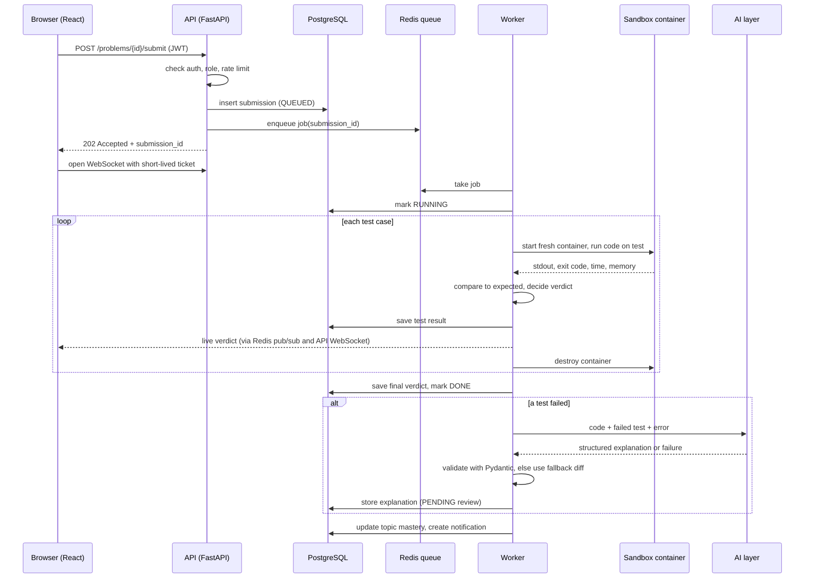
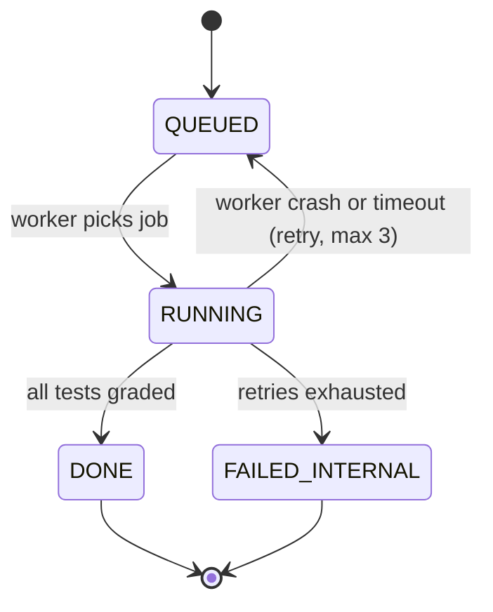

# Workflow Diagrams

## 1. Submit flow (end to end)

## 2. Job lifecycle and crash recovery

## 3. Trust boundaries
- Browser is untrusted: the API re-checks everything.
- User code is hostile: it runs only inside the sandbox.
- AI output is untrusted: it is validated, reviewable and can never alter a verdict.