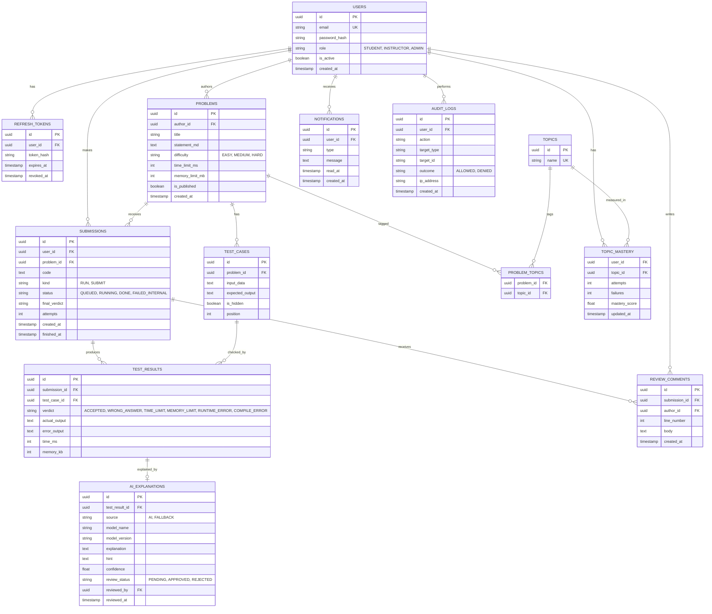

# ER Diagram

## Design notes
- UUID primary keys: ids cannot be guessed, which helps object-level authorization.
- `test_results` is one row per test, which gives live updates and per-topic analytics.
- Only hashes of refresh tokens are stored, so a database leak cannot be replayed.
- `ai_explanations` is separate from verdicts, so AI can never overwrite a grade.
- `TOPIC_MASTERY` has a composite key (`user_id`, `topic_id`); indexes will be added with the analytics queries in Phase 6.